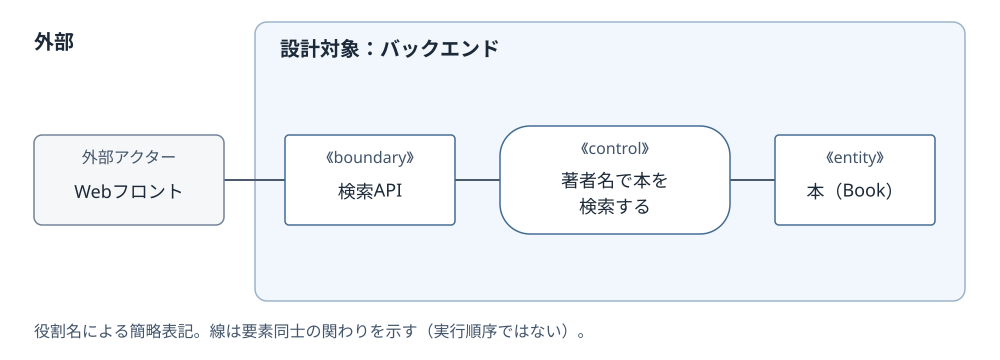
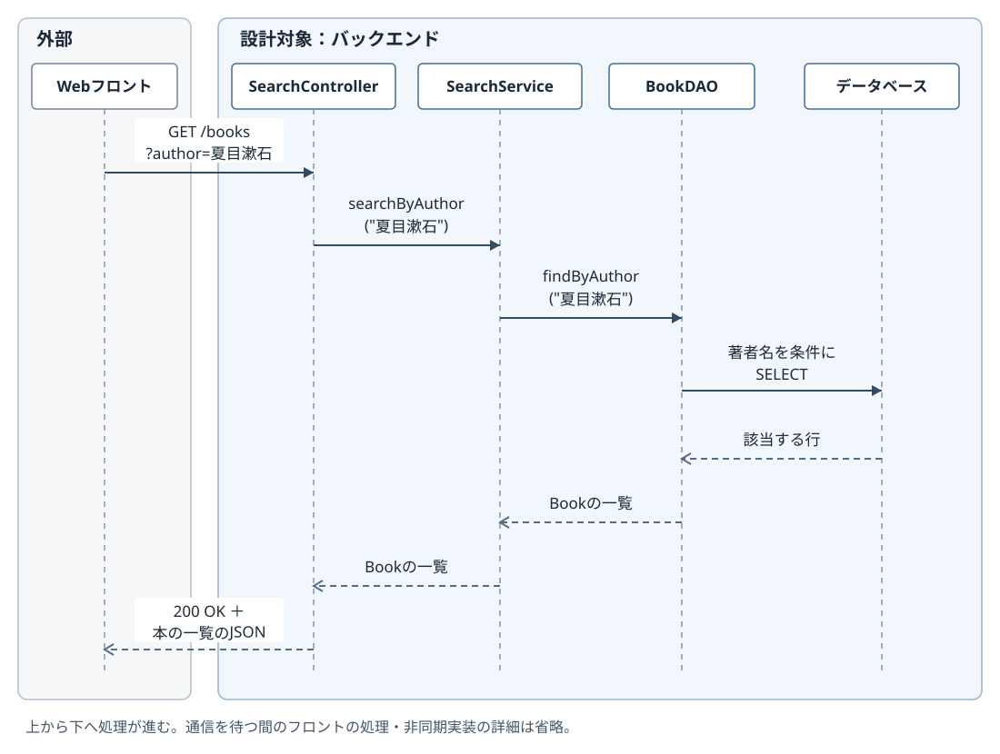

# バックエンドの設計図に、フロントとバウンダリをどう描くか

- 記録日：2026-10-27
- 分類：技術書の読書・設計の学習ログ
- 読書対象：『ユースケース駆動開発実践ガイド』第8章、pp.211–212付近

読書中の疑問と、対話を通じて整理した理解を記録する。図とクラス構成は説明用に作成した本検索APIの例であり、書籍の図の再現や、実際に実装・検証したシステムの記録ではない。

## 1. バウンダリが画面なら、バックエンドの設計と混ざらないか

書籍のシーケンス図では、検索ページなどの画面がバウンダリオブジェクトとして登場する。そこで、バックエンドを開発する場合にも画面を描くなら、フロントとバックエンドの処理が混同されるのではないか、と疑問を持った。

「バックエンドだけを設計するなら、フロントを外部の呼び出し元に置ける」という説明だけではイメージできなかったため、同じ検索処理をロバストネス図とシーケンス図で具体化した。

整理の起点になったのは、**どこまでを今回の設計対象にするのか**という区別だった。

## 2. 「外部」は、今回設計する範囲の外という意味

バックエンドだけを設計する場合、Webフロントを「APIを呼ぶ相手」として描き、バックエンド内部を詳しく設計する。フロントの入力欄や表示処理まで、この図で詳しく扱う必要はない。

| 設計する範囲 | 外部の呼び出し元 | バウンダリの例 |
| --- | --- | --- |
| 利用者が使うアプリ全体 | 利用者 | 検索画面 |
| バックエンドのAPI | WebフロントなどのAPIクライアント | HTTPリクエストを受け付ける検索APIの窓口 |

ここでの「外部」は、別会社や別サービスという意味に限らない。同じアプリのフロントでも、バックエンドを設計対象に選べば、その範囲の外になる。

バウンダリは設計対象と外部との接点を担当するもので、必ず画面を意味するわけではない。画面以外の境界インターフェースも表せる。[1]

## 3. ロバストネス図：接点・必要な処理・扱う情報

例として、フロントの検索画面に著者名を入力すると、本の一覧を返すAPIを考える。正常に検索できる流れに絞り、必要な要素を整理した。

[図のMermaidソース](diagrams/261027-backend-robustness.mmd)

専用の丸い記号の代わりに、役割名を明記した簡略表記としている。

- **外部アクター：Webフロント** — バックエンドに検索を依頼する。
- **boundary：検索API** — 外部からの依頼を受け付ける窓口。
- **control：著者名で本を検索する** — 実現しなければならない処理。
- **entity：本（Book）** — 検索で扱う業務上の情報・オブジェクト。

線は要素同士の関わりを示している。この簡略図の並びを、そのまま実行順序やメソッド呼び出しとして読むわけではない。

また、この段階で「著者名で本を検索する」という独立したControllerクラスを必ず作る、と決めたわけでもない。まず、必要な処理と、それに関わる接点・情報を整理している。

## 4. シーケンス図：担当クラスとメソッドを具体化する

次に、必要な処理をどのクラスのメソッドで実現するか決める。今回は次の分担にした。

- `SearchController`：HTTPリクエストを受け取り、検索処理を呼び、結果をレスポンスとして返す。
- `SearchService`：検索処理を取りまとめる。
- `BookDAO`：データベースへ検索を依頼し、取得した行を`Book`の一覧として返す。

[図のMermaidソース](diagrams/261027-backend-sequence.mmd)

**フロントの列には、APIへの依頼と応答だけを描いている。** 検索ボタンのイベントハンドラ、入力状態の管理、結果の表示方法などは、この図の設計対象に含めていない。

フロントからControllerへの矢印はHTTPリクエストであり、ControllerからService、ServiceからDAOへの矢印はバックエンド内のメソッド呼び出しである。実際のURLでは著者名を適切にエンコードするが、図では読みやすさのため日本語で表記した。

依頼と応答の順序を描いているのであって、ブラウザ全体が応答まで停止するという意味ではない。待ち時間に行う画面処理や、非同期通信の実装詳細は省略している。戻り値の受け渡しを確認するため、今回は戻りの矢印も描いた。

## 5. 2つの図の要素は、一対一のクラス対応ではない

| ロバストネス図で整理したもの | 今回の詳細設計 |
| --- | --- |
| 検索APIという窓口（boundary） | `SearchController`が担当する |
| 著者名で本を検索する処理（control） | `SearchService.searchByAuthor()`と`BookDAO.findByAuthor()`などで実現する |
| 本という情報（entity） | 検索結果として渡される`Book`オブジェクトになる |

`Book`は結果として受け渡しているため、このシーケンス図では独立したライフラインを設けていない。ロバストネス図にある要素を、すべて同じ形でシーケンス図の上に並べる必要はない。

一方、DAOとデータベースは詳細設計で具体化した技術上の要素である。`Book`は業務オブジェクト、DAOはデータアクセスの担当、データベースは保存先として区別する。この例で`Book`自身がDAOを呼ぶ設計にはしていない。

## 6. Controllerという名前と、ロバストネス図のcontrolは別に考える

ここで注意したいのは、**今回の`SearchController`は、APIの窓口としてboundaryに対応する**という点である。

ロバストネス図のboundary・control・entityは、モデル上の役割を整理するための分類である。実装クラスの名前に`Controller`が付くから、必ずロバストネス図のcontrolになる、と機械的には決められない。

同様に、ロバストネス図のcontrolをすべて独立したControllerクラスへ変換する必要もない。必要な処理は残し、その担当を適切なクラスのメソッドへ割り当てる。

今回は説明のためにServiceを独立させたが、すべての検索APIに同じ構成が必須という意味ではない。controlを一つ描くたびに、Serviceを一つ増やすという規則でもない。

## 7. 今回整理できたこと

最初は「バウンダリ＝画面」と捉えていたため、バックエンドだけの設計にも画面が入り込み、フロントと混ざるように感じていた。設計対象の範囲と、外部との接点を分けることで、読み方を整理できた。

- 先に、アプリ全体を描くのか、バックエンドだけを描くのかを明示する。
- ロバストネス図で、接点・必要な処理・扱う情報を整理する。
- シーケンス図で、実際の担当クラスとメソッドの呼び出しを具体化する。
- 図に画面やAPIが登場しても、その名前だけで実行場所や実装方式を決めつけない。

フロントとバックエンドを同じシーケンス図に描くこと自体は矛盾しない。どこを詳しく設計し、どこを呼び出し元として扱うかを明示することが、混同を防ぐために必要だと理解した。

## 参考資料

- ダグ・ローゼンバーグ／マット・ステファン『ユースケース駆動開発実践ガイド』第8章、pp.211–212付近。ロバストネス図の処理を操作へ割り当てる説明と、シーケンス図の記法を読んだ際の疑問が出発点。
- [1] Sparx Systems, [Boundary — Enterprise Architect User Guide](https://www.sparxsystems.com/enterprise_architect_user_guide/17.0/modeling_languages/boundary.html)。画面以外の境界インターフェースも表せることの確認先。APIを使った本記事の図とクラス構成は説明用の設計例。

## 追記：フロー図とロバストネス図は、細かさより注目する対象が違う

追記日：2026-10-29

### 疑問から整理したこと

「ロバストネス図の方が詳細設計につながりやすく、粒度も細かいのか」と考えた。詳細設計につながりやすいという理解は合っているが、粒度が常に細かいわけではない。

**フロー図は処理の順番・条件分岐、ロバストネス図は利用者・接点・必要な処理・業務データの関わりに注目する。** フロー図も計算手順や分岐を細かく描けば、ロバストネス図より詳細になる。

| 観点 | フロー図 | ロバストネス図 |
| --- | --- | --- |
| 主な関心 | 何を、どの順番・条件で実行するか | どの接点・処理・業務オブジェクトが関わるか |
| 見つけやすい不足 | エラー時の分岐や処理手順の抜け | 必要な画面・APIの窓口、処理、扱う情報の抜け |
| 詳細設計へのつながり | 手順や分岐を具体化する材料 | クラスの候補を見つけ、処理を操作へ割り当てる材料 |

これは注目点の比較であり、フロー図では担当やデータを一切表せないという意味ではない。

### レビューの検証を例にする

説明用の書店を考える。フロー図で「ログイン確認→入力→検証→登録」と描けば、手順が分かる。ロバストネス図では「顧客」「レビュー入力画面」「レビューを検証する処理」「レビュー」などを結び付け、どの接点から入力を受け、何を検証するかを考える。

その後の詳細設計で、検証処理を例えば CustomerReview.validate() に割り当てる。ロバストネス図のコントローラは必要な処理を表しており、その段階で独立したControllerクラスの作成を確定するわけではない。

**ロバストネス図は、単にフロー図を細かくしたものではなく、ユースケースの手順をオブジェクトの設計へ結び付けるための図。** 分岐の整理にはフロー図、接点・処理・業務データの関係の整理にはロバストネス図、具体的な呼び出し順序と操作の割り当てにはシーケンス図、という使い分けで考える。

必要な関係や責務を別の方法で十分に検討できるなら、すべての図を必ず作る必要はない。

### 着想の起点と補足の区別

- 書籍：ダグ・ローゼンバーグ／マット・ステファン『ユースケース駆動開発実践ガイド』
- 該当箇所：第8章、ロバストネス図のコントローラを操作に割り当てる説明
- ページ番号：Kindle版 p.211
- 原文の抜粋：

> エンティティクラスおよびバウンダリクラスのひとつまたはそれ以上の操作として実装されます

原文は会話で共有された引用から抜粋した。フロー図との比較とレビュー検証の説明例は、この説明を踏まえた会話上の整理であり、書籍本文の引用ではない。
